<a id="top"></a>

<picture>
  <source media="(prefers-color-scheme: dark)" srcset="docs/assets/banner-dark.svg">
  <source media="(prefers-color-scheme: light)" srcset="docs/assets/banner-light.svg">
  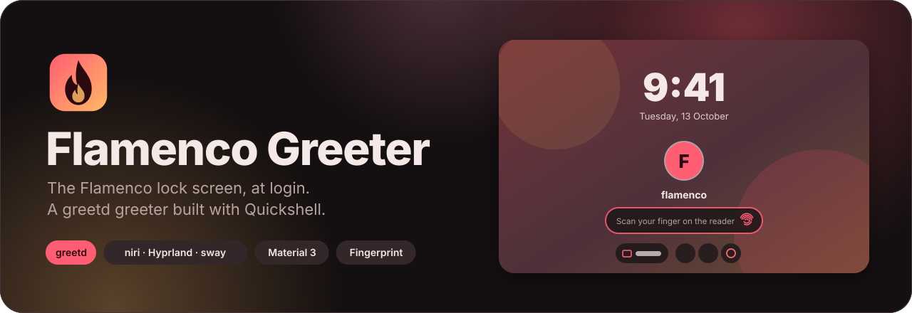
</picture>

<p align="center">
  
  
  
  
  
</p>

<p align="center">
  <a href="#gallery"><b>📸 Gallery</b></a> &nbsp;·&nbsp;
  <a href="#features"><b>✨ Features</b></a> &nbsp;·&nbsp;
  <a href="#install"><b>🚀 Install</b></a> &nbsp;·&nbsp;
  <a href="#configure"><b>⚙️ Configure</b></a> &nbsp;·&nbsp;
  <a href="#fingerprint"><b>👆 Fingerprint</b></a> &nbsp;·&nbsp;
  <a href="#troubleshooting"><b>🛟 Help</b></a> &nbsp;·&nbsp;
  <a href="#reference"><b>📚 Reference</b></a>
</p>

<a id="about"></a>

## 💃 About

Flamenco Greeter is the login screen for [Flamenco Shell](https://github.com/niruxx/flamenco-shell). It's built from the same Theme, palettes, fonts and controls as the shell's lock screen, so logging in, locking and unlocking all look like one screen. It runs under [greetd](https://sr.ht/~kennylevinsen/greetd/) and follows the model of [DMS greeter](https://github.com/AvengeMedia/dank-greeter): a small [Quickshell](https://quickshell.org) UI inside a minimal compositor, plus one command that brings your theme across.

<table>
  <tr>
    <td width="33%" valign="top">
      <h3>🎨 Your theme, at login</h3>
      Palette, light or dark mode, accent, roundness, fonts, wallpaper and avatar, all taken from your Flamenco settings.
    </td>
    <td width="33%" valign="top">
      <h3>🔒 One screen, everywhere</h3>
      The same clock, avatar, password pill, motion and power row as the lock screen, using the shell's own components.
    </td>
    <td width="33%" valign="top">
      <h3>👆 Fingerprint ready</h3>
      The reader starts listening as soon as you're picked. A typed password always works too, with no waiting for the scan.
    </td>
  </tr>
  <tr>
    <td width="33%" valign="top">
      <h3>👥 Every user</h3>
      A user picker with avatars, and each user's own theme cross-fades in as you switch between them.
    </td>
    <td width="33%" valign="top">
      <h3>🧭 niri first</h3>
      Runs on niri, Hyprland or sway, generating the compositor config with your keyboard layout and cursor.
    </td>
    <td width="33%" valign="top">
      <h3>🛡️ Private by design</h3>
      Only what the login screen needs leaves your home directory, into a folder only the greeter can read.
    </td>
  </tr>
</table>

<details>
<summary><b>📑 Table of contents</b></summary>

- [📸 Gallery](#gallery)
- [✨ Features](#features)
- [🚀 Install](#install): prebuilt package, build the package, from source
- [⚙️ Configure](#configure): turn it on, sync your theme, what carries over, compositor & monitors, launcher options
- [👆 Fingerprint login](#fingerprint)
- [🛟 Troubleshooting](#troubleshooting)
- [📚 Reference](#reference): commands, files, how a login works
- [🛠️ Development](#development)

</details>

<a id="gallery"></a>

## 📸 Gallery

<p align="center">
  
</p>

<table>
  <tr>
    <td width="50%" align="center"><br><b>👥 User picker</b></td>
    <td width="50%" align="center">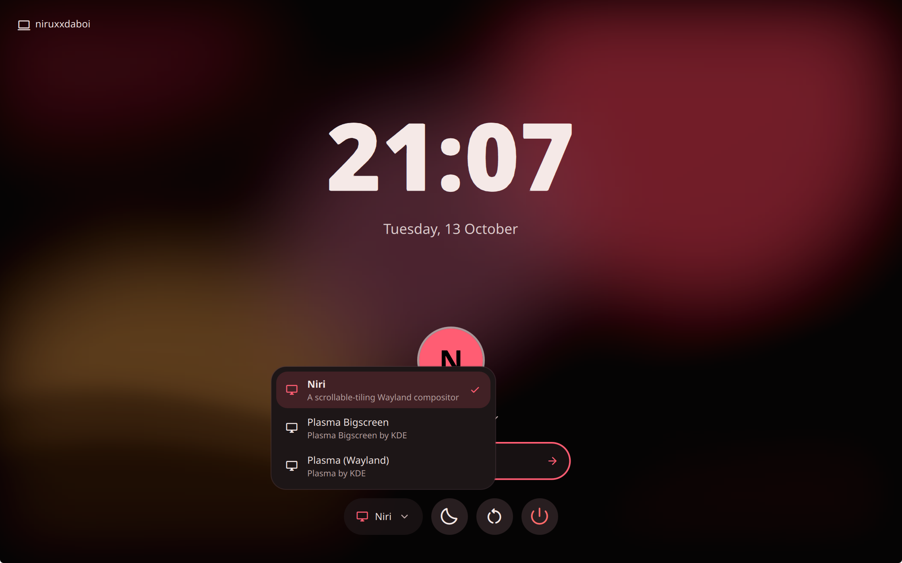<br><b>🖥️ Session chooser</b></td>
  </tr>
  <tr>
    <td align="center">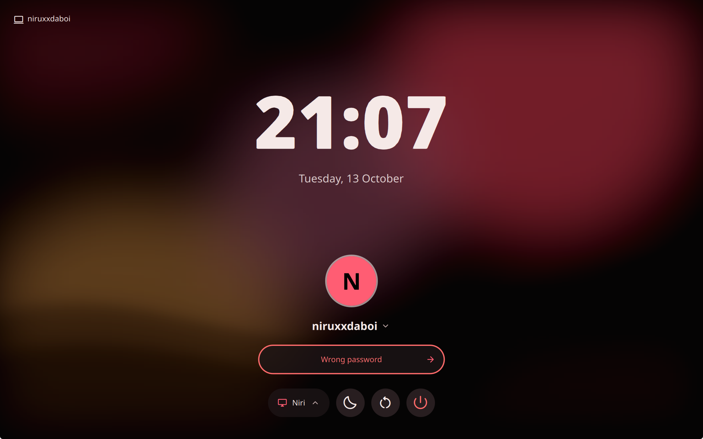<br><b>🔑 Wrong password</b></td>
    <td align="center">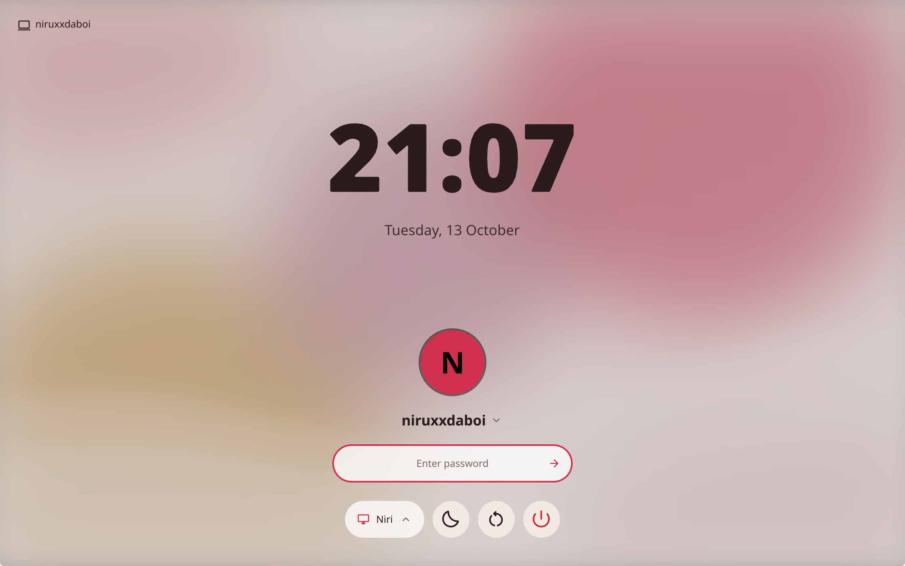<br><b>☀️ Light mode</b></td>
  </tr>
</table>

### 👆 Fingerprint login

<table>
  <tr>
    <td width="33%" align="center">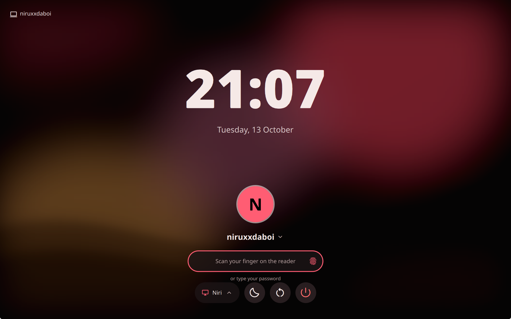<br><b>Scan your finger</b></td>
    <td width="33%" align="center">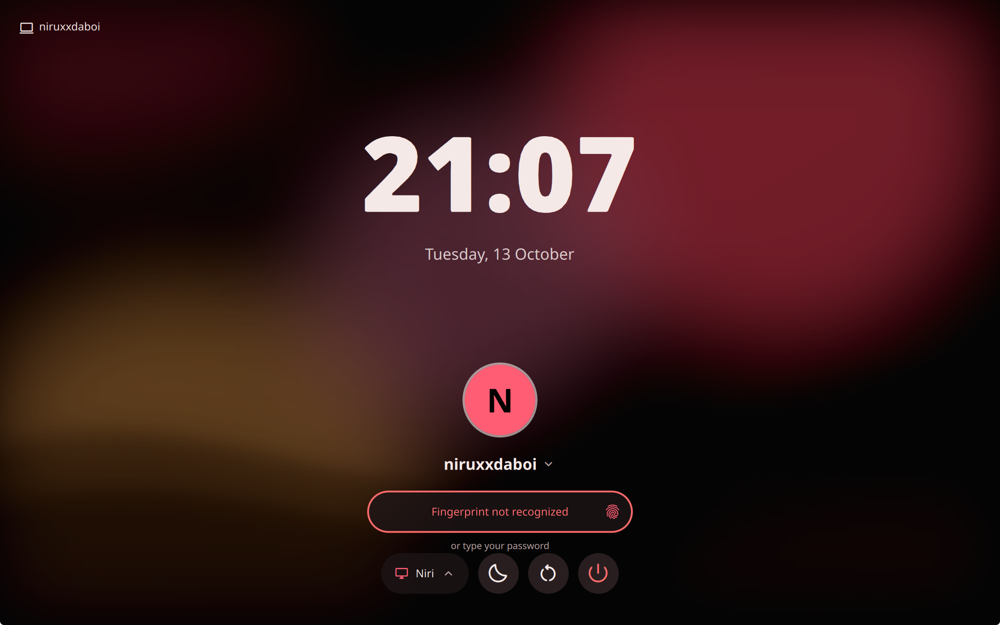<br><b>Not recognized</b></td>
    <td width="33%" align="center"><br><b>Or type a password</b></td>
  </tr>
</table>

### 🌈 Wears every Flamenco palette

<table>
  <tr>
    <td width="25%" align="center">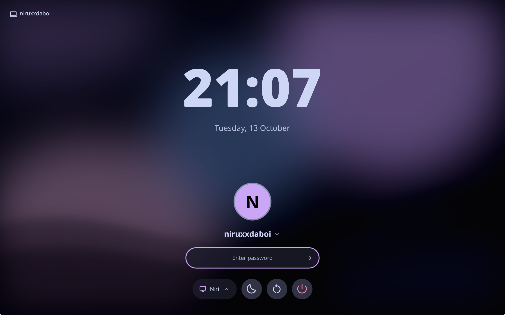<br>Catppuccin</td>
    <td width="25%" align="center">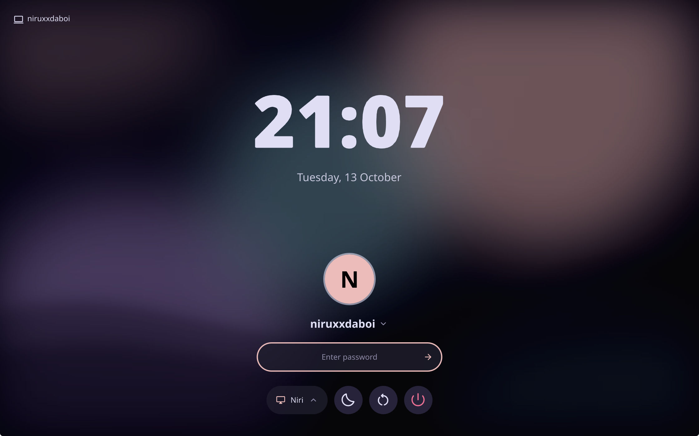<br>Rosé Pine</td>
    <td width="25%" align="center">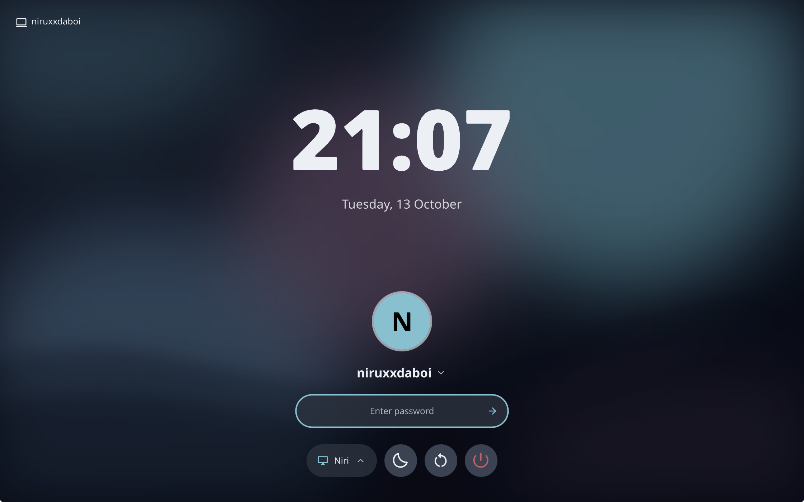<br>Nord</td>
    <td width="25%" align="center">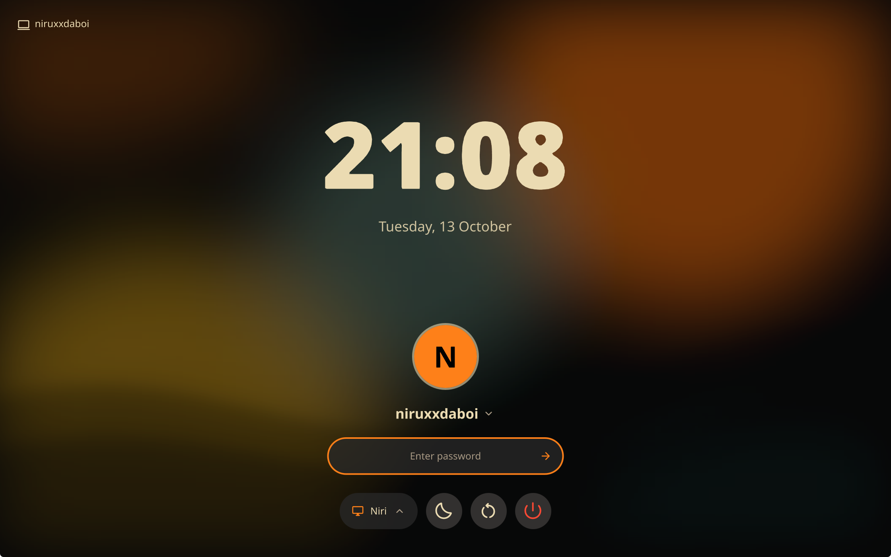<br>Gruvbox</td>
  </tr>
  <tr>
    <td align="center">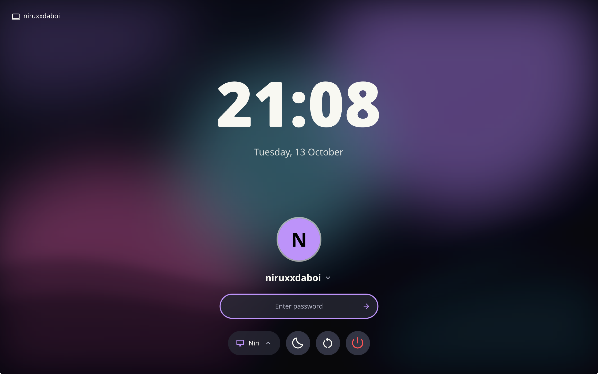<br>Dracula</td>
    <td align="center">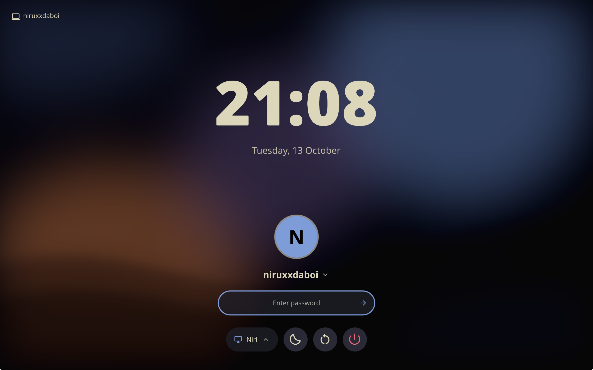<br>Kanagawa</td>
    <td align="center">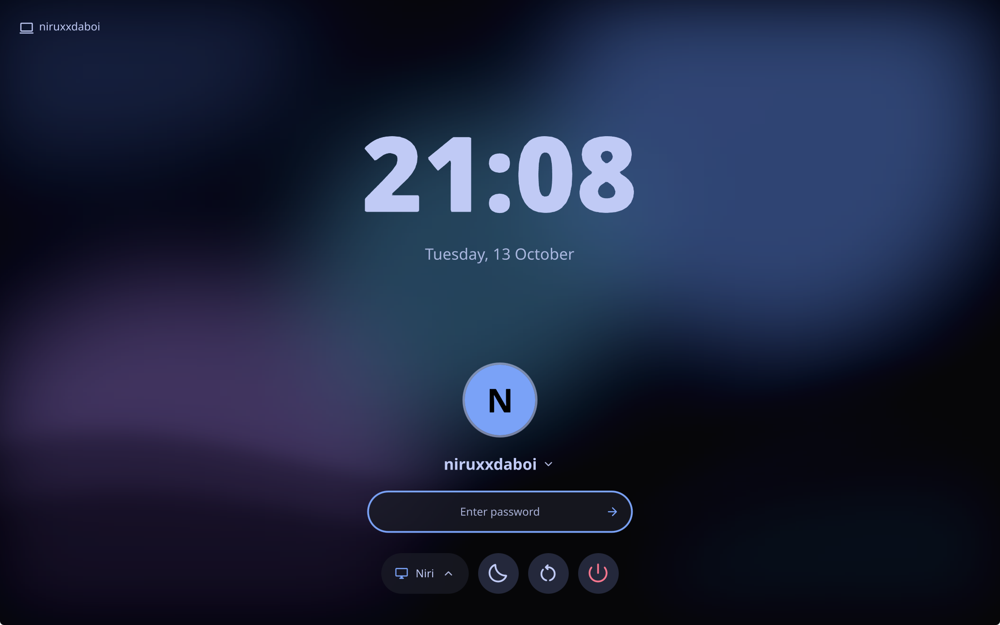<br>Tokyo Night</td>
    <td align="center">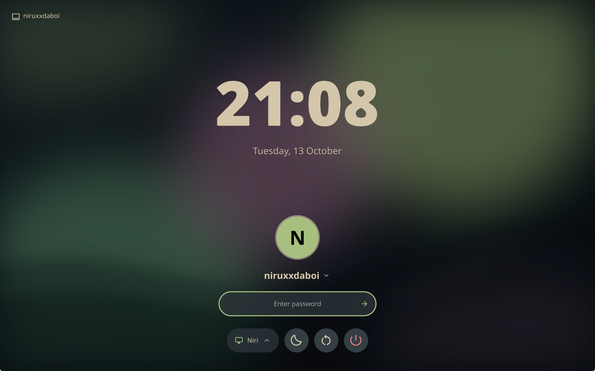<br>Everforest</td>
  </tr>
</table>

> [!NOTE]
> The screenshots are of `flamenco-greeter preview` running with generated wallpapers. Regenerate them with `tools/screenshots.sh`.

<p align="right"><a href="#top">⬆️ Back to top</a></p>

<a id="features"></a>

## ✨ Features

| | |
|---|---|
| 🎨 **Your theme** | Palette (including colors from your wallpaper via `matugen`), light/dark mode, accent, roundness, fonts, UI scale and animation speed all come from your Flamenco settings. |
| 🔒 **Lock screen layout** | Clock, avatar, password pill with animated dots, a shake on a wrong password, and suspend, restart and power-off along the bottom. |
| 👥 **Multiple users** | Picker with avatars, plus *Other user…* for typing a name. Each synced user brings their own palette and wallpaper, which cross-fade in. |
| 🖥️ **Session chooser** | Every installed Wayland session, plus X11 sessions when `startx` is available. niri is preselected the first time. |
| 🧠 **Remembers you** | The last user and session are preselected next time. Turn this off with `--no-save-username` / `--no-save-session`. |
| ⌨️ **Your keyboard & cursor** | Layout, variant, options, repeat rate, numlock and cursor theme are applied to the greeter's compositor, so your password types the same as on the desktop. |
| 👆 **Fingerprint** | With fprintd: the reader listens as soon as a user is picked, "Scan your finger on the reader" appears, and a typed password skips the scan instantly. |
| 🔐 **Extra PAM prompts** | One-time codes, token PINs and lockout notices show up in the password field. |
| 🪟 **niri, Hyprland or sway** | The compositor config is generated at every start. Your own monitor layout can be included. |
| 🖥️ **Multi-monitor** | Every screen gets the wallpaper and clock. The first screen gets the login card. |

<p align="right"><a href="#top">⬆️ Back to top</a></p>

<a id="install"></a>

## 🚀 Install

**Requirements:** [Flamenco Shell](https://github.com/niruxx/flamenco-shell) (the greeter reuses its theme code), `greetd`, `quickshell`, `python`, `python-gobject`, and a compositor (`niri`, `hyprland` or `sway`). Optional: `fprintd` for fingerprint login, `matugen` for wallpaper colors, `upower` for the battery indicator.

### 📦 Option 1: the prebuilt package (Arch Linux)

Every release is kept under [`History Builds/`](History%20Builds), one folder per version:

```sh
sudo pacman -S --needed greetd quickshell python-gobject niri   # if not installed yet
sudo pacman -U "History Builds/flamenco-greeter-0.2.0-1/flamenco-greeter-0.2.0-1-any.pkg.tar.zst"
```

Pacman's systemd hooks create the `greeter` user and the `/var/cache/flamenco-greeter` data folder automatically.

### 🛠️ Option 2: build the package yourself

```sh
git clone https://github.com/niruxx/flamenco-greeter.git
cd flamenco-greeter/packaging/arch
makepkg -si                      # build and install in one go
```

Or run `packaging/arch/build-local.sh` to build into a new `History Builds/flamenco-greeter-<version>-<rel>/` folder without installing.

### 🧰 Option 3: from source (any distro)

```sh
sudo make install                                  # installs to /usr
sudo systemd-sysusers && sudo systemd-tmpfiles --create
```

If Flamenco Shell isn't at `/usr/share/flamenco-shell/shell`, pass its location: `sudo make install SHELL_DIR=/path/to/flamenco-shell/shell`.

> [!TIP]
> Run `flamenco-greeter preview` before switching anything on. It opens the greeter in a window with your current theme. In preview, any password except `wrong` "logs in", and nothing is actually started.

<p align="right"><a href="#top">⬆️ Back to top</a></p>

<a id="configure"></a>

## ⚙️ Configure

### 1. Turn it on

```sh
flamenco-greeter enable          # niri (default); or: enable hyprland | enable sway
```

This shows what it will write, asks before changing anything, then:

- writes `/etc/greetd/config.toml` (backing up the old one) to start `flamenco-greeter --command niri` as the `greeter` user;
- makes greetd the display manager (`systemctl enable -f greetd`), replacing SDDM, GDM or similar;
- offers fingerprint login if it finds a reader.

<details>
<summary>Prefer to edit greetd's config yourself?</summary>

```toml
# /etc/greetd/config.toml
[terminal]
vt = 1

[default_session]
user = "greeter"
command = "/usr/bin/flamenco-greeter --command niri"
```

Then run `sudo systemctl enable -f greetd`. A copy lives at [`examples/config.toml`](examples/config.toml).
</details>

### 2. Bring your theme across

```sh
flamenco-greeter sync
```

This copies your palette, wallpaper and avatar to the login screen. Run it again after changing your theme. It asks for sudo once unless you're in the `greeter` group.

**Keep it in sync automatically:**

```sh
sudo usermod -aG greeter $USER                            # then log out and back in
systemctl --user enable --now flamenco-greeter-sync.path
```

From then on, every change you make in Flamenco Settings reaches the login screen by itself, with no password prompts.

### 3. Check everything

```sh
flamenco-greeter doctor
```

```text
 ✓ greetd installed
 ✓ Quickshell installed
 ✓ a compositor (niri, Hyprland or sway)
 ✓ greeter UI at /usr/share/flamenco-greeter/greeter
 ✓ Flamenco Shell components linked
 ✓ 'greeter' user exists
 ✓ /var/cache/flamenco-greeter exists
 ✓ theme synced for alice
 ✓ greetd uses flamenco-greeter
```

Reboot (or `sudo systemctl restart greetd` from a TTY) and you're done.

### 🎨 What carries over from Flamenco Settings

| Settings page | On the login screen |
|---|---|
| **Appearance** | Palette (or colors from your wallpaper), dark/light mode, accent color, roundness, font, UI scale, animation speed |
| **Wallpaper** | The current wallpaper, blurred behind the login card like the lock screen |
| **About** | Your profile picture (or `~/.face`) |
| **Clock** | 24-hour or 12-hour time |
| **Keyboard** | Layout, variant, options, model, repeat delay and rate, numlock |
| **App theming** | Cursor theme and size (when that theme is installed system-wide) |

Nothing else is copied. Shortcuts, autostart entries, your weather city and the rest stay in your home directory, and the copy is readable only by the `greeter` user and group.

### 🖥️ Monitors & compositor tweaks

The greeter's compositor doesn't read your desktop config. For niri, put monitor layout (or anything else) in `/etc/greetd/flamenco-niri.kdl` and it's included automatically:

```kdl
// /etc/greetd/flamenco-niri.kdl
output "DP-1" {
    mode "2560x1440@165"
    scale 1.25
}
output "eDP-1" { off; }
```

For Hyprland or sway, pass a config to start from. The greeter's own lines are appended:

```toml
command = "/usr/bin/flamenco-greeter --command hyprland -C /etc/greetd/hypr-outputs.lua"
```

### 🚩 Launcher options

Add these after `--command` in greetd's `command = "…"` line:

| Option | What it does |
|---|---|
| `--command niri\|hyprland\|sway` | Compositor that hosts the login screen (required) |
| `-C, --config PATH` | Compositor config to start from (e.g. monitor layout) |
| `--no-save-username` | Don't preselect the last user |
| `--no-save-session` | Don't preselect the last session |
| `--cache-dir DIR` | Use a different data folder (default `/var/cache/flamenco-greeter`) |
| `-p, --path DIR` | Run a different copy of the greeter UI |
| `--debug` | Log to the terminal instead of the journal |

<p align="right"><a href="#top">⬆️ Back to top</a></p>

<a id="fingerprint"></a>

## 👆 Fingerprint login

```sh
sudo pacman -S fprintd
fprintd-enroll                         # enroll a finger for your user
flamenco-greeter fingerprint enable    # adds pam_fprintd to /etc/pam.d/greetd (backed up first)
flamenco-greeter fingerprint status    # reader, PAM and enrolled fingers at a glance
```

`fingerprint disable` removes it again. If your PAM setup already uses `pam_fprintd` (directly, or through an included file like `system-auth`), it's detected and left alone.

**On the login screen:**

- 👆 **Picked users are checked right away.** The greeter starts a PAM login as soon as a user is selected. If that user has fingers enrolled, the reader starts and the field reads **"Scan your finger on the reader"**. Users without fingers simply see the password field.
- ❌ **Missed scans keep your typing.** A finger that doesn't match shakes the field and shows *Fingerprint not recognized*, without clearing what you've typed. After six misses the reader rests until the user is picked again.
- 🔁 **It keeps listening.** When a scan times out, a new one starts, so the reader is always ready while the screen is idle.
- ⌨️ **Passwords never wait.** Pressing Enter on a typed password briefly claims the reader, so PAM skips straight to checking your password.

> [!NOTE]
> The greeter never asks fprintd about other users' fingers. That would need a polkit right that would also let the login screen *enroll* fingers for anyone. `pam_fprintd` does the check itself, as root.

<p align="right"><a href="#top">⬆️ Back to top</a></p>

<a id="troubleshooting"></a>

## 🛟 Troubleshooting

<details>
<summary><b>Black screen, or the greeter doesn't appear</b></summary>

Switch to another TTY with <kbd>Ctrl</kbd>+<kbd>Alt</kbd>+<kbd>F2</kbd>, log in, and read the logs:

```sh
journalctl -b -t flamenco-greeter/niri      # or flamenco-greeter/hyprland, /sway
flamenco-greeter doctor
```

To go back to your previous display manager in the meantime: `sudo systemctl enable -f sddm` (or `gdm`, …) and reboot.
</details>

<details>
<summary><b>The login screen has the default theme or wallpaper</b></summary>

Run `flamenco-greeter sync`. If you changed your theme since, run it again, or set up automatic sync (see [Configure](#configure)).
</details>

<details>
<summary><b>My password is "wrong" but works on the desktop</b></summary>

The greeter uses the keyboard layout from your last sync. Run `flamenco-greeter sync` after changing layouts in Settings → Keyboard.
</details>

<details>
<summary><b>The fingerprint message never shows</b></summary>

Run `flamenco-greeter fingerprint status`: it checks that fprintd runs, a reader is found, `pam_fprintd` is in greetd's PAM stack and your fingers are enrolled. The login screen only listens when a reader is present *and* fingerprint login is enabled.
</details>

<details>
<summary><b>A typed password waits a while when fingerprint login is on</b></summary>

The greeter couldn't claim the reader (look for "couldn't hold the reader" in the journal), so the password is sent once the scan round ends, after up to 30 seconds.
</details>

<details>
<summary><b>The wrong monitor gets the login card</b></summary>

The first screen the compositor reports gets it. Turn off the outputs you don't want at login in `/etc/greetd/flamenco-niri.kdl` (see [Monitors](#configure)).
</details>

<p align="right"><a href="#top">⬆️ Back to top</a></p>

<a id="reference"></a>

## 📚 Reference

### Commands

| Command | |
|---|---|
| `flamenco-greeter enable [niri\|hyprland\|sway]` | Point greetd at the greeter and make it the display manager |
| `flamenco-greeter sync [--quiet] [--no-sudo]` | Copy your theme, wallpaper and avatar to the login screen |
| `flamenco-greeter fingerprint status\|enable\|disable` | Manage fingerprint login |
| `flamenco-greeter preview [--fingerprint] [--palette P] [--mode M] [--wallpaper W]` | Try the greeter in a window (`--fingerprint` adds a pretend reader) |
| `flamenco-greeter doctor [--json]` | Check the setup |
| `flamenco-greeter --command niri …` | Start the greeter (what greetd runs) |

### How a login works

<picture>
  <source media="(prefers-color-scheme: dark)" srcset="docs/assets/flow-dark.svg">
  <source media="(prefers-color-scheme: light)" srcset="docs/assets/flow-light.svg">
  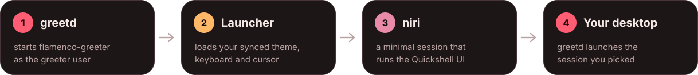
</picture>

1. **greetd** starts `flamenco-greeter --command niri` as the `greeter` user.
2. **The launcher** puts the last user's synced settings where the shell's `Settings` reads them, writes a niri config with their keyboard layout and cursor, and starts niri.
3. **niri** runs the Quickshell UI. It lists users and sessions, preselects the remembered ones, and talks to greetd (opening the PAM session right away when fingerprint login is on).
4. **Your desktop:** on success it plays the lock screen's exit animation, and greetd launches the session you picked.

### Files

```text
/etc/greetd/config.toml                 greetd: which greeter to run
/etc/greetd/flamenco-niri.kdl           optional: extra niri config (monitors…)
/etc/pam.d/greetd                       PAM stack (fingerprint block added by `fingerprint enable`)
/usr/share/flamenco-greeter/greeter/    the UI; Commons/, Widgets/, assets/ link to Flamenco Shell
/var/cache/flamenco-greeter/            greeter:greeter, 2770
  users/<name>/settings.json            your synced settings (written by `sync`)
  users/<name>/wallpaper.*, face        your wallpaper and avatar
  state/memory.json                     last user + session
```

<p align="right"><a href="#top">⬆️ Back to top</a></p>

<a id="development"></a>

## 🛠️ Development

```sh
make dev          # link ../flamenco-shell/shell's Commons, Widgets and assets into ./greeter
make preview      # run it in a window from this checkout (hot-reloads)
```

Drive a preview over IPC:

```sh
qs -p greeter ipc call greeter menu users      # or: sessions, ""
qs -p greeter ipc call greeter type hunter2
qs -p greeter ipc call greeter submit
qs -p greeter ipc call greeter finger true     # with --fingerprint: a matching (true) or wrong (false) finger
```

| Tool | |
|---|---|
| `tools/screenshots.sh` | Capture the README screenshots (KDE Spectacle or niri) |
| `tools/readme-assets.py` | Redraw the banners and diagram from the shell's palettes |
| `packaging/arch/build-local.sh` | Build the Arch package into `History Builds/` |

```text
bin/flamenco-greeter        launcher, sync, enable, fingerprint, preview, doctor, and the probes the UI uses
greeter/shell.qml           entry: a layer-shell surface per screen, or a window in preview
greeter/Modules/Greeter/    the login screen, user/session menus, avatar
greeter/Services/           greetd conversation + state, memory, power
data/                       sysusers, tmpfiles, sync units
```

<p align="center"><sub>Made to match <a href="https://github.com/niruxx/flamenco-shell">Flamenco Shell</a> · 💃</sub></p>
