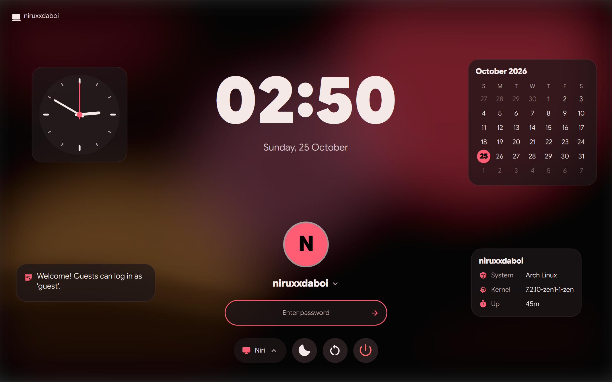
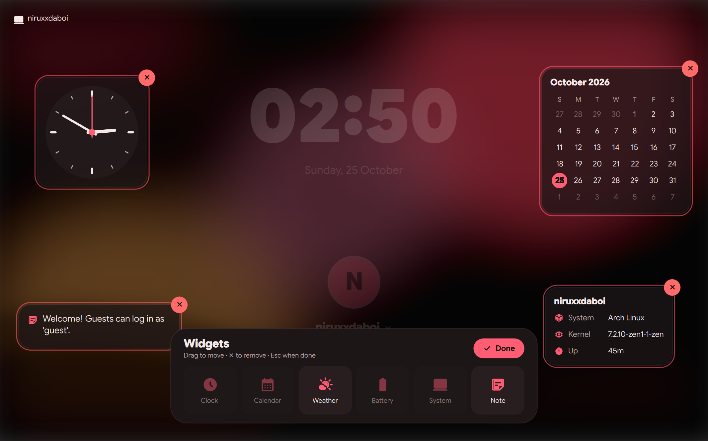

<a id="top"></a>

<picture>
  <source media="(prefers-color-scheme: dark)" srcset="docs/assets/banner-dark.svg">
  <source media="(prefers-color-scheme: light)" srcset="docs/assets/banner-light.svg">
  
</picture>

<p align="center">
  
  
  
  
  
</p>

<p align="center">
  <a href="#gallery"><b>📸 Gallery</b></a> &nbsp;·&nbsp;
  <a href="#features"><b>✨ Features</b></a> &nbsp;·&nbsp;
  <a href="#install"><b>🚀 Install</b></a> &nbsp;·&nbsp;
  <a href="#configure"><b>⚙️ Configure</b></a> &nbsp;·&nbsp;
  <a href="#lock-and-login"><b>🔗 Lock &amp; Login</b></a> &nbsp;·&nbsp;
  <a href="#widgets"><b>🧩 Widgets</b></a> &nbsp;·&nbsp;
  <a href="#fingerprint"><b>👆 Fingerprint</b></a> &nbsp;·&nbsp;
  <a href="#doctor"><b>🩺 Doctor</b></a> &nbsp;·&nbsp;
  <a href="#troubleshooting"><b>🛟 Help</b></a> &nbsp;·&nbsp;
  <a href="#reference"><b>📚 Reference</b></a>
</p>

<a id="about"></a>

## 💃 About

Flamenco Greeter is the login screen for [Flamenco Shell](https://github.com/niruxx/flamenco-shell). It's built from the same Theme, palettes, fonts and controls as the shell's lock screen, so logging in, locking and unlocking all look like one screen. It runs under [greetd](https://sr.ht/~kennylevinsen/greetd/) and follows the model of [DMS greeter](https://github.com/AvengeMedia/dank-greeter): a small [Quickshell](https://quickshell.org) UI inside a minimal compositor, plus one command that brings your theme across.

<table>
  <tr>
    <td width="33%" valign="top">
      <h3>🎨 Your theme, at login</h3>
      Palette, light or dark mode, accent, roundness, fonts, wallpaper and avatar, all taken from your Flamenco settings.
    </td>
    <td width="33%" valign="top">
      <h3>🔒 One screen, everywhere</h3>
      The same clock, avatar, password pill, motion and power row as the lock screen, using the shell's own components.
    </td>
    <td width="33%" valign="top">
      <h3>👆 Fingerprint ready</h3>
      The reader starts listening as soon as you're picked. A typed password always works too, and a finger still wins while it's checked.
    </td>
  </tr>
  <tr>
    <td width="33%" valign="top">
      <h3>👥 Every user</h3>
      A user picker with avatars, and each user's own theme cross-fades in as you switch between them.
    </td>
    <td width="33%" valign="top">
      <h3>🧭 niri first</h3>
      Runs on niri, Hyprland or sway, generating the compositor config with your keyboard layout and cursor.
    </td>
    <td width="33%" valign="top">
      <h3>🛡️ Private by design</h3>
      Only what the login screen needs leaves your home directory, into a folder only the greeter can read.
    </td>
  </tr>
  <tr>
    <td width="33%" valign="top">
      <h3>🧩 Widgets</h3>
      Press and hold the background to add a clock, calendar, weather, battery, system info or a note, and drag them anywhere.
    </td>
    <td width="33%" valign="top">
      <h3>🩺 Never a black screen</h3>
      If the login screen can't start, you get a text login with the reason instead of a black screen that keeps retrying.
    </td>
    <td width="33%" valign="top">
      <h3>🔎 A real doctor</h3>
      <code>flamenco-greeter doctor</code> checks packages, greetd, PAM, the UI itself and the logs, and says what to run next.
    </td>
  </tr>
</table>

<details>
<summary><b>📑 Table of contents</b></summary>

- [📸 Gallery](#gallery)
- [✨ Features](#features)
- [🚀 Install](#install): prebuilt package, build the package, from source
- [⚙️ Configure](#configure): turn it on, sync your theme, what carries over, compositor & monitors, launcher options
- [🔗 Flamenco Shell's Lock & Login](#lock-and-login): Apply, live wallpapers, what wins
- [🧩 Widgets](#widgets)
- [👆 Fingerprint login](#fingerprint)
- [🩺 When the login screen won't start](#doctor): the doctor, the text-login fallback
- [🛟 Troubleshooting](#troubleshooting)
- [📚 Reference](#reference): commands, files, how a login works
- [🛠️ Development](#development)

</details>

<a id="gallery"></a>

## 📸 Gallery

<p align="center">
  
</p>

<table>
  <tr>
    <td width="50%" align="center"><br><b>👥 User picker</b></td>
    <td width="50%" align="center"><br><b>🖥️ Session chooser</b></td>
  </tr>
  <tr>
    <td align="center"><br><b>🔑 Wrong password</b></td>
    <td align="center"><br><b>☀️ Light mode</b></td>
  </tr>
</table>

### 🧩 Widgets

<table>
  <tr>
    <td width="50%" align="center"><br><b>Clock, calendar, a note and system info</b></td>
    <td width="50%" align="center"><br><b>Press and hold to edit</b></td>
  </tr>
</table>

### 👆 Fingerprint login

<table>
  <tr>
    <td width="33%" align="center"><br><b>Scan your finger</b></td>
    <td width="33%" align="center"><br><b>Not recognized</b></td>
    <td width="33%" align="center"><br><b>Or type a password</b></td>
  </tr>
</table>

### 🌈 Wears every Flamenco palette

<table>
  <tr>
    <td width="25%" align="center"><br>Catppuccin</td>
    <td width="25%" align="center"><br>Rosé Pine</td>
    <td width="25%" align="center"><br>Nord</td>
    <td width="25%" align="center"><br>Gruvbox</td>
  </tr>
  <tr>
    <td align="center"><br>Dracula</td>
    <td align="center"><br>Kanagawa</td>
    <td align="center"><br>Tokyo Night</td>
    <td align="center"><br>Everforest</td>
  </tr>
</table>

> [!NOTE]
> The screenshots are of `flamenco-greeter preview` running with generated wallpapers. Regenerate them with `tools/screenshots.sh`.

<p align="right"><a href="#top">⬆️ Back to top</a></p>

<a id="features"></a>

## ✨ Features

| | |
|---|---|
| 🎨 **Your theme** | Palette (including colors from your wallpaper via `matugen`), light/dark mode, accent, roundness, fonts, UI scale and animation speed all come from your Flamenco settings. |
| 🔒 **Lock screen layout** | Clock, avatar, password pill with animated dots, a shake on a wrong password, and suspend, restart and power-off along the bottom. |
| 👥 **Multiple users** | Picker with avatars, plus *Other user…* for typing a name. Each synced user brings their own palette and wallpaper, which cross-fade in. |
| 🖥️ **Session chooser** | Every installed Wayland session, plus X11 sessions when `startx` is available. niri is preselected the first time. |
| 🧠 **Remembers you** | The last user and session are preselected next time. Turn this off with `--no-save-username` / `--no-save-session`. |
| ⌨️ **Your keyboard & cursor** | Layout, variant, options, repeat rate, numlock and cursor theme are applied to the greeter's compositor, so your password types the same as on the desktop. |
| 👆 **Fingerprint** | With fprintd: the reader listens as soon as a user is picked, "Scan your finger on the reader" appears, and a typed password goes in as soon as the current scan ends. |
| 🧩 **Widgets** | Press and hold the background to add a clock, calendar, weather, battery, system info or notes, then drag them into place. |
| 🔗 **Lock & Login** | Everything you set in Flamenco Shell's Settings → Lock & Login and **Apply**: wallpaper or color, blur and dim, fonts, avatars, sessions, users, power buttons, fingerprint. |
| 🎞️ **Live wallpapers** | A video or GIF wallpaper plays behind the login card, as on the desktop: muted, at the shell's speed, fading in over its still. |
| 🩺 **Self-checks** | The UI is test-loaded before every start after an update; if it's broken, or keeps crashing, you get a text login with the reason. `flamenco-greeter doctor` explains the rest. |
| 🔐 **Extra PAM prompts** | One-time codes, token PINs and lockout notices show up in the password field. |
| 🪟 **niri, Hyprland or sway** | The compositor config is generated at every start. Your own monitor layout can be included. |
| 🖥️ **Multi-monitor** | Every screen gets the wallpaper and clock. The first screen gets the login card. |

<p align="right"><a href="#top">⬆️ Back to top</a></p>

<a id="install"></a>

## 🚀 Install

**Requirements:** [Flamenco Shell](https://github.com/niruxx/flamenco-shell) (the greeter reuses its theme code), `greetd`, `quickshell`, `python`, and a compositor (`niri`, `hyprland` or `sway`). Optional: `qt6-multimedia` for live (video) wallpapers, `ffmpeg` for their stills, `fprintd` for fingerprint login, `matugen` for wallpaper colors, `upower` for the battery indicator.

### 📦 Option 1: the prebuilt package (Arch Linux)

Every release is kept under [`History Builds/`](History%20Builds), one folder per version:

```sh
sudo pacman -S --needed greetd quickshell niri   # if not installed yet
sudo pacman -U "History Builds/flamenco-greeter-0.4.0-1/flamenco-greeter-0.4.0-1-any.pkg.tar.zst"
```

Pacman's systemd hooks create the `greeter` user and the `/var/cache/flamenco-greeter` data folder automatically.

### 🛠️ Option 2: build the package yourself

```sh
git clone https://github.com/niruxx/flamenco-greeter.git
cd flamenco-greeter/packaging/arch
makepkg -si                      # build and install in one go
```

Or run `packaging/arch/build-local.sh` to build into a new `History Builds/flamenco-greeter-<version>-<rel>/` folder without installing.

### 🧰 Option 3: from source (any distro)

```sh
sudo make install                                  # installs to /usr
sudo systemd-sysusers && sudo systemd-tmpfiles --create
```

If Flamenco Shell isn't at `/usr/share/flamenco-shell/shell`, pass its location: `sudo make install SHELL_DIR=/path/to/flamenco-shell/shell`.

> [!TIP]
> Run `flamenco-greeter preview` before switching anything on. It opens the greeter in a window with your current theme. In preview, any password except `wrong` "logs in", and nothing is actually started.

<p align="right"><a href="#top">⬆️ Back to top</a></p>

<a id="configure"></a>

## ⚙️ Configure

### 1. Turn it on

```sh
flamenco-greeter enable          # niri (default); or: enable hyprland | enable sway
```

This shows what it will write, asks before changing anything, then:

- writes `/etc/greetd/config.toml` (backing up the old one) to start `flamenco-greeter --command niri` as the `greeter` user;
- makes greetd the display manager (`systemctl enable -f greetd`), replacing SDDM, GDM or similar;
- offers fingerprint login if it finds a reader.

<details>
<summary>Prefer to edit greetd's config yourself?</summary>

```toml
# /etc/greetd/config.toml
[terminal]
vt = 1

[default_session]
user = "greeter"
command = "/usr/bin/flamenco-greeter --command niri"
```

Then run `sudo systemctl enable -f greetd`. A copy lives at [`examples/config.toml`](examples/config.toml).
</details>

### 2. Bring your theme across

```sh
flamenco-greeter sync
```

This copies your palette, wallpaper and avatar to the login screen. Run it again after changing your theme. It asks for sudo once unless you're in the `greeter` group.

**Keep it in sync automatically:**

```sh
sudo usermod -aG greeter $USER                            # then log out and back in
systemctl --user enable --now flamenco-greeter-sync.path
```

From then on, every change you make in Flamenco Settings reaches the login screen by itself, with no password prompts: a new wallpaper (live ones included), a new profile picture, palette or font.

### 3. Check everything

```sh
flamenco-greeter doctor
```

It should end with *Everything looks right*. Then reboot (or `sudo systemctl restart greetd` from a TTY) and you're done. See [the doctor](#doctor) for what it checks.

### 🎨 What carries over from Flamenco Settings

| Settings page | On the login screen |
|---|---|
| **Appearance** | Palette (or colors from your wallpaper), dark/light mode, accent color, roundness, font, UI scale, animation speed |
| **Wallpaper** | The current wallpaper, **live ones playing** (videos, GIFs, at the same speed, muted); with *per screen* on, each screen's own; fill mode (crop, fit, stretch) |
| **About** | Your profile picture (or `~/.face`) |
| **Clock** | 24-hour or 12-hour time |
| **Keyboard** | Layout, variant, options, model, repeat delay and rate, numlock |
| **App theming** | Cursor theme and size (when that theme is installed system-wide) |

Nothing else is copied. Shortcuts, autostart entries, your weather city and the rest stay in your home directory, and the copy is readable only by the `greeter` user and group.

### 🖥️ Monitors & compositor tweaks

The greeter's compositor doesn't read your desktop config. For niri, put monitor layout (or anything else) in `/etc/greetd/flamenco-niri.kdl` and it's included automatically:

```kdl
// /etc/greetd/flamenco-niri.kdl
output "DP-1" {
    mode "2560x1440@165"
    scale 1.25
}
output "eDP-1" { off; }
```

For Hyprland or sway, pass a config to start from. The greeter's own lines are appended:

```toml
command = "/usr/bin/flamenco-greeter --command hyprland -C /etc/greetd/hypr-outputs.lua"
```

### 🚩 Launcher options

Add these after `--command` in greetd's `command = "…"` line:

| Option | What it does |
|---|---|
| `--command niri\|hyprland\|sway` | Compositor that hosts the login screen (required) |
| `-C, --config PATH` | Compositor config to start from (e.g. monitor layout) |
| `--no-save-username` | Don't preselect the last user |
| `--no-save-session` | Don't preselect the last session |
| `--cache-dir DIR` | Use a different data folder (default `/var/cache/flamenco-greeter`) |
| `-p, --path DIR` | Run a different copy of the greeter UI |
| `--debug` | Log to the terminal instead of the journal |

<p align="right"><a href="#top">⬆️ Back to top</a></p>

<a id="lock-and-login"></a>

## 🔗 Flamenco Shell's Lock & Login

Flamenco Shell has a page for the login screen: **Settings → Lock & Login**. Choose there, press **Apply**, and the next login screen shows it. Apply writes `config.json`, the wallpaper and avatars to `/var/cache/flamenco-greeter` ([the format](https://github.com/niruxx/flamenco-shell/blob/main/docs/greeter.md)), and the greeter reads all of it, even while it's running:

| In Lock & Login | On the login screen |
|---|---|
| Wallpaper: desktop, custom image or color | The background, with its fill mode |
| Blur, dim | How blurred and how dark the background is (0 blur is a sharp wallpaper) |
| Font, mono font, text size | The login screen's type |
| Your picture | The avatar, for each user it was applied for |
| Session picker, default session, hidden sessions | Whether the session chip shows, which session is preselected, which are left out |
| User list, remember last user | A list of users or a name to type, and whether the last one is preselected |
| Power buttons | Suspend, restart and shut down at the bottom |
| Fingerprint | Whether the reader listens (see [Fingerprint login](#fingerprint)) |

**What wins when both are set.** `flamenco-greeter sync` brings each user's *own* theme and wallpaper; Lock & Login sets the *login screen's*. So:

- Colors: the selected user's synced theme when there is one, else the colors Apply sent.
- Wallpaper: Lock & Login's custom image or color always. If it's set to *desktop*, the selected user's own synced wallpaper is used (so a live one plays, and per-screen ones show), falling back to the one Apply sent.
- Fonts, text size, clock, and every option in the table: Lock & Login.

### 🎞️ Live wallpapers

A video or GIF wallpaper plays behind the login card, muted, at the speed set in the shell, fading in over its still once the first frame is up. Turning live wallpapers off in the shell shows the still instead. Videos need `qt6-multimedia` (without it, the still shows).

- **Synced:** `flamenco-greeter sync` copies the video and its still (the shell's own poster, or one made with `ffmpeg`).
- **Applied:** today's Flamenco Shell sends only a still for a live wallpaper (GIFs already animate). [`contrib/flamenco-shell-live-wallpaper.patch`](contrib/flamenco-shell-live-wallpaper.patch) makes Apply send the video too, and say whether the picture is the desktop's, a backward-compatible change to `config.json` (`wallpaper.live`, `liveSpeed`, `source`) documented in the shell's `docs/greeter.md`. Apply it in your flamenco-shell checkout with `git apply`.

### Try it before logging out

```sh
flamenco-greeter preview                 # your synced theme + what Lock & Login applied
flamenco-greeter preview --as-applied    # only what Apply sent, as on a machine nobody synced
flamenco-greeter preview --from DIR      # a Lock & Login folder from somewhere else
```

<p align="right"><a href="#top">⬆️ Back to top</a></p>

<a id="widgets"></a>

## 🧩 Widgets

**Press and hold** anywhere on the login screen's background (or on a widget) for a moment. A ring grows under the pointer, then the screen switches to editing:

- **Add** a widget from the sheet at the bottom: **Clock** (analog), **Calendar**, **Weather**, **Battery**, **System** (host, OS, kernel, uptime) or **Note**.
- **Move** a widget by dragging it; **remove** it with its ✕.
- **Set up** the Weather widget by typing a city right on it (°C/°F with the thermometer button), and write a Note in place.
- **Finish** with *Done*, <kbd>Esc</kbd>, or a click on an empty spot.

Widgets belong to the login screen, not to a user: everyone who logs in on this computer sees the same layout, saved in `/var/cache/flamenco-greeter/state/widgets.json`. Positions are kept as fractions of the screen, so a layout survives a resolution change.

```sh
flamenco-greeter widgets list      # what's on the login screen
flamenco-greeter widgets lock      # stop anyone editing them (holding the background does nothing)
flamenco-greeter widgets unlock
flamenco-greeter widgets reset     # remove them all
```

> [!TIP]
> Try layouts from your desktop with `flamenco-greeter preview`: it starts from the login screen's current widgets (or `--widgets FILE`), and nothing you change there touches the real login screen.

<p align="right"><a href="#top">⬆️ Back to top</a></p>

<a id="fingerprint"></a>

## 👆 Fingerprint login

```sh
sudo pacman -S fprintd
fprintd-enroll                         # enroll a finger for your user
flamenco-greeter fingerprint enable    # adds pam_fprintd to /etc/pam.d/greetd (backed up first)
flamenco-greeter fingerprint status    # reader, PAM and enrolled fingers at a glance
```

`fingerprint disable` removes it again. If your PAM setup already uses `pam_fprintd` (directly, or through an included file like `system-auth`), it's detected and left alone.

**On the login screen:**

- 👆 **Picked users are checked right away.** The greeter starts a PAM login as soon as a user is selected. If that user has fingers enrolled, the reader starts and the field reads **"Scan your finger on the reader"**. Users without fingers simply see the password field.
- ❌ **Missed scans keep your typing.** A finger that doesn't match shakes the field and shows *Fingerprint not recognized*, without clearing what you've typed. After six misses the reader rests until the user is picked again.
- 🔁 **It keeps listening.** When a scan times out, a new one starts, so the reader is always ready while the screen is idle.
- ⌨️ **Passwords always work.** greetd can't interrupt a scan, so a password typed while the reader listens goes in the moment the current round ends (rounds are 10 seconds), with *Finishing the fingerprint scan…* shown meanwhile. Touching the reader still logs you in straight away.

> [!NOTE]
> The greeter never asks fprintd about other users' fingers. That would need a polkit right that would also let the login screen *enroll* fingers for anyone. `pam_fprintd` does the check itself, as root.

<p align="right"><a href="#top">⬆️ Back to top</a></p>

<a id="doctor"></a>

## 🩺 When the login screen won't start

### Text login instead of a black screen

The most common breakage is an update: Flamenco Shell changes in a way this greeter version doesn't expect, the interface fails to load, Quickshell exits, and greetd starts it again and again on a black screen. The launcher guards against that:

- After any update (to the greeter, Flamenco Shell or Quickshell), it **test-loads the interface off-screen** before starting the compositor. That takes about a second, once.
- It **counts crashes**: three within five minutes and it stops retrying.
- It **validates the niri config**, and retries once without `-C` and `/etc/greetd/flamenco-niri.kdl` if one of those has a mistake.

When any of these fail, you get greetd's text login (`agreety`) with the reason at the top, so you can still log in, and the next start tries the real login screen again:

```text
  Flamenco Greeter couldn't start: its interface doesn't load: caused by
  @Modules/Greeter/GreeterMenu.qml[57:25]: Cannot assign to non-existent property "source"

  Log in below. Afterwards, run `flamenco-greeter doctor` to see what's wrong.
```

### The doctor

```sh
sudo flamenco-greeter doctor      # works from a TTY; with sudo it also reads the logs
flamenco-greeter check            # the same thing
flamenco-greeter doctor --json    # for scripts
```

It checks everything the login screen depends on, groups the results, and puts the next step under anything that's wrong (✓ fine · ✗ problem · ! warning · · note):

| Section | What it looks at |
|---|---|
| **Dependencies** | greetd and its text login (`agreety`), Quickshell and its greetd support, the configured compositor, Python, optional tools |
| **greetd** | `/etc/greetd/config.toml` parses and runs flamenco-greeter correctly (`--command`, `-C`, `-p`, the user); `greetd.service` enabled and running; other display managers (SDDM, GDM, …) that are still enabled; greetd's own log |
| **Greeter interface** | the UI files, the links into Flamenco Shell, and a real off-screen load of every QML file, with the exact file and line when one breaks |
| **Authentication (PAM)** | `/etc/pam.d/greetd` and every PAM module it uses (following includes), fingerprint setup |
| **Greeter user and data** | the `greeter` user, the data folder's owner and permissions, whether your theme is synced and up to date, widgets |
| **Flamenco Shell login settings** | what Lock & Login last applied and when, that its wallpaper and avatars are there, Qt Multimedia for a live wallpaper, its options |
| **Compositor and display** | the niri (or sway) config the launcher would write, checked with `niri validate`; whether the seat has a usable GPU |
| **Desktop sessions** | installed sessions and whether their programs exist |
| **Recent trouble** | crashes, text-login fallbacks, and errors from the greeter's log this boot |

An example from a machine where an update broke the interface and an old display manager was left enabled:

```text
Flamenco Greeter 0.4.0 · doctor (as root)

[✓] Dependencies
    ✓ greetd 0.10.3
    ✓ agreety (greetd's text login, the fallback when the greeter can't start)
    ✓ Quickshell 0.3.2
    ✓ Quickshell has greetd support
    ✓ niri 26.04 (the compositor the greeter runs in)

[✗] greetd
    ✓ /etc/greetd/config.toml parses
    ✓ runs flamenco-greeter in niri as greeter
    ✓ greetd.service is enabled
    ✗ sddm.service is enabled too; two login screens fight over the display
      → sudo systemctl disable sddm
    ✓ greetd is running (restarted 14 times)

[✗] Greeter interface
    ✓ UI at /usr/share/flamenco-greeter/greeter
    ✓ Flamenco Shell 0.45.0-1 at /usr/share/flamenco-shell/shell
    ✗ the interface fails to load, so the login screen would stay black
        caused by @Modules/Greeter/GreeterMenu.qml[57:25]: Cannot assign to non-existent property "source"
      → update flamenco-greeter and flamenco-shell together; the errors say which file broke

[✗] Recent trouble
    ✗ the login screen crashed 3 times in the last hour
    ! fell back to a text login Sun 09:12: its interface doesn't load: …

3 problems, 1 warning. Fix the ✗ items above, then restart the login screen: sudo systemctl restart greetd
```

<p align="right"><a href="#top">⬆️ Back to top</a></p>

<a id="troubleshooting"></a>

## 🛟 Troubleshooting

<details>
<summary><b>Black screen, a text login, or the greeter keeps restarting</b></summary>

If you got the text login, log in there. Otherwise switch to another TTY with <kbd>Ctrl</kbd>+<kbd>Alt</kbd>+<kbd>F2</kbd> and log in. Then:

```sh
sudo flamenco-greeter doctor
```

It names the broken piece and the command to fix it. The full greeter log is in `journalctl -b -t flamenco-greeter/niri` (or `/hyprland`, `/sway`). To go back to your previous display manager in the meantime: `sudo systemctl enable -f sddm` (or `gdm`, …) and reboot.
</details>

<details>
<summary><b>The login screen broke after updating Flamenco Shell</b></summary>

The greeter uses the shell's theme code directly, so the two should be updated together. Update flamenco-greeter, then check with `sudo flamenco-greeter doctor` (the *Greeter interface* section loads the UI and shows any error). Until then, the launcher gives you a text login instead of a black screen.
</details>

<details>
<summary><b>Holding the background doesn't edit widgets</b></summary>

Editing may be locked: `flamenco-greeter widgets unlock`. Holding only works on empty background or on a widget, not on the login card.
</details>

<details>
<summary><b>The login screen has the default theme or wallpaper</b></summary>

Run `flamenco-greeter sync`. If you changed your theme since, run it again, or set up automatic sync (see [Configure](#configure)).
</details>

<details>
<summary><b>My password is "wrong" but works on the desktop</b></summary>

The greeter uses the keyboard layout from your last sync. Run `flamenco-greeter sync` after changing layouts in Settings → Keyboard.
</details>

<details>
<summary><b>The fingerprint message never shows</b></summary>

Run `flamenco-greeter fingerprint status`: it checks that fprintd runs, a reader is found, `pam_fprintd` is in greetd's PAM stack and your fingers are enrolled. The login screen only listens when a reader is present *and* fingerprint login is enabled.
</details>

<details>
<summary><b>A typed password waits a while when fingerprint login is on</b></summary>

A password typed during a scan is checked when that scan round ends, up to 10 seconds later. If it takes much longer, your PAM setup still uses longer rounds: run `flamenco-greeter fingerprint status`, then `flamenco-greeter fingerprint enable` to update it. If `pam_fprintd` comes from your own PAM config, give it `max-tries=1 timeout=10`.
</details>

<details>
<summary><b>The wrong monitor gets the login card</b></summary>

The first screen the compositor reports gets it. Turn off the outputs you don't want at login in `/etc/greetd/flamenco-niri.kdl` (see [Monitors](#configure)).
</details>

<p align="right"><a href="#top">⬆️ Back to top</a></p>

<a id="reference"></a>

## 📚 Reference

### Commands

| Command | |
|---|---|
| `flamenco-greeter enable [niri\|hyprland\|sway]` | Point greetd at the greeter and make it the display manager |
| `flamenco-greeter sync [--quiet] [--no-sudo]` | Copy your theme, wallpaper and avatar to the login screen |
| `flamenco-greeter fingerprint status\|enable\|disable` | Manage fingerprint login |
| `flamenco-greeter widgets list\|lock\|unlock\|reset` | Manage the login screen's widgets |
| `flamenco-greeter preview [--fingerprint] [--palette P] [--mode M] [--wallpaper W] [--widgets FILE] [--from DIR] [--as-applied]` | Try the greeter in a window (`--fingerprint` adds a pretend reader; `--as-applied` shows only what Lock & Login applied) |
| `flamenco-greeter doctor [--json]` (or `check`) | Check everything the login screen needs |
| `flamenco-greeter --command niri …` | Start the greeter (what greetd runs) |

### How a login works

<picture>
  <source media="(prefers-color-scheme: dark)" srcset="docs/assets/flow-dark.svg">
  <source media="(prefers-color-scheme: light)" srcset="docs/assets/flow-light.svg">
  
</picture>

1. **greetd** starts `flamenco-greeter --command niri` as the `greeter` user.
2. **The launcher** puts the last user's synced settings where the shell's `Settings` reads them, writes a niri config with their keyboard layout and cursor, and starts niri.
3. **niri** runs the Quickshell UI. It lists users and sessions, preselects the remembered ones, and talks to greetd (opening the PAM session right away when fingerprint login is on).
4. **Your desktop:** on success it plays the lock screen's exit animation, and greetd launches the session you picked.

### Files

```text
/etc/greetd/config.toml                 greetd: which greeter to run
/etc/greetd/flamenco-niri.kdl           optional: extra niri config (monitors…)
/etc/pam.d/greetd                       PAM stack (fingerprint block added by `fingerprint enable`)
/usr/share/flamenco-greeter/greeter/    the UI; Commons/, Widgets/, assets/ link to Flamenco Shell
/var/cache/flamenco-greeter/            greeter:greeter (Flamenco Shell's Apply makes it 0755)
  config.json, wallpaper.*, avatars/    Lock & Login, written by Flamenco Shell's Apply (root's, read-only)
  wallpaper-live.*                      the live wallpaper's video, with the shell patch in contrib/
  users/<name>/settings.json            your synced settings (written by `sync`)
  users/<name>/wallpaper.*, face        your wallpaper and avatar; a video's still is <video>.jpg
  users/<name>/screen-N.*               per-screen wallpapers
  state/memory.json                     last user + session
  state/widgets.json                    the login screen's widgets
  state/failures, state/fallback        crash and text-login history (read by `doctor`)
  state/run-greeter.sh                  what the compositor runs: the UI, noting crashes
```

<p align="right"><a href="#top">⬆️ Back to top</a></p>

<a id="development"></a>

## 🛠️ Development

```sh
make dev          # link ../flamenco-shell/shell's Commons, Widgets and assets into ./greeter
make preview      # run it in a window from this checkout (hot-reloads)
```

Drive a preview over IPC:

```sh
qs -p greeter ipc call greeter menu users      # or: sessions, ""
qs -p greeter ipc call greeter type hunter2
qs -p greeter ipc call greeter submit
qs -p greeter ipc call greeter finger true     # with --fingerprint: a matching (true) or wrong (false) finger
qs -p greeter ipc call greeter edit true       # widget editing on/off
qs -p greeter ipc call greeter addWidget clock
qs -p greeter ipc call greeter grab /tmp/shot.png   # save the screen as a PNG
```

`FLAMENCO_GREETER_WINDOWED=1` runs the real greeter (real greetd conversation, no fake login) in a window, which is how `tools/test-login.sh` drives it.

| Tool | |
|---|---|
| `tools/test-login.sh` | Run log-in scenarios (password, fingerprint, both at once) against `tools/mock-greetd.py` |
| `tools/screenshots.sh` | Capture the README screenshots (any desktop; the greeter saves its own window) |
| `tools/readme-assets.py` | Redraw the banners and diagram from the shell's palettes |
| `packaging/arch/build-local.sh` | Build the Arch package into `History Builds/` |

```text
bin/flamenco-greeter        launcher, sync, enable, fingerprint, preview, doctor, and the probes the UI uses
greeter/shell.qml           entry: a layer-shell surface per screen, or a window in preview
greeter/Modules/Greeter/    the login screen, user/session menus, avatar, Login*Widget.qml widgets
greeter/Services/           greetd conversation + state, memory, power, widget layouts
data/                       sysusers, tmpfiles, sync units
```

<p align="center"><sub>Made to match <a href="https://github.com/niruxx/flamenco-shell">Flamenco Shell</a> · 💃</sub></p>
